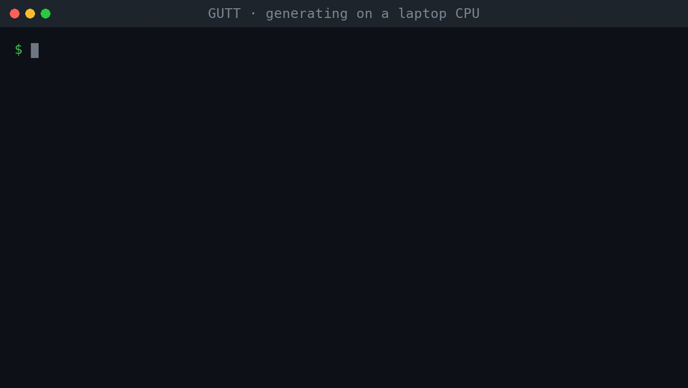
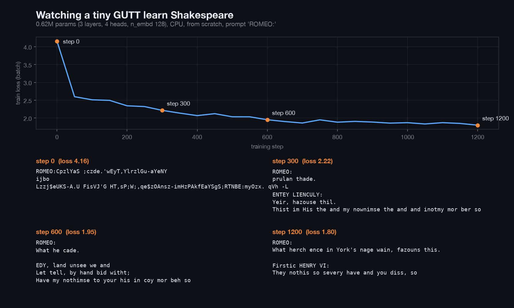

# Ground-Up-Trained-Transformer (GUTT)



GUTT is a character-level GPT written from scratch in PyTorch and trained on Tiny Shakespeare. It is not a wrapper around a pretrained model. The token and position embeddings, causal self-attention, multi-head attention, feed-forward blocks, training loop and sampler all live in this repo, and the committed checkpoint was trained here. It generates play-format text one character at a time. It was built by the CBU ACM Software Engineering Team.

## Quickstart

```bash
git clone https://github.com/Kipung/Ground-Up-Trained-Transformer && cd Ground-Up-Trained-Transformer
python -m venv .venv && source .venv/bin/activate   # Windows: .venv\Scripts\activate
pip install -r requirements.txt && python generate.py --prompt "ROMEO:" --chars 400 --seed 2 --temperature 0.8
```

`generate.py` streams characters as they are sampled and picks CUDA, then Apple MPS, then CPU. Use `--device cpu` to force a device. Output depends on device as well as seed, so the sample below comes from `--device cpu`.

On Windows with an NVIDIA GPU, `build.bat` creates a `cuda` virtualenv and installs the CUDA build of PyTorch. The original loop still works too: `python src/runtime/entry_point.py` prints a new 300-character sample every 5 seconds.

## Sample output

From `python generate.py --prompt "ROMEO:" --chars 400 --temperature 0.8 --seed 2 --device cpu`:

```
ROMEO:
Good lord; I'll return them again.

KING RICHARD III:
Do you hope me, I love thy word, my lord?

BUCKINGHAM:
I could not see thy sir,
Which is love to see this double light.

BUCKINGHAM:
Good my lord; good night, to the lord.

GLOUCESTER:
How now! what commands you have a friend?

BRUTUS:
And he was a remember of our hearts,
That she hath a fair hope, and less me be my brother,
By brister him gav
```

The model learned the layout of a play, real character names and mostly real words. It does not write coherent sentences.

## Architecture

Settings are in `src/parameters.py`.

| Setting | Value |
| --- | --- |
| Layers | 6 |
| Attention heads | 8 (head size 64) |
| Embedding size | 512 |
| Context length | 64 characters |
| Dropout | 0.2 |
| Vocabulary | 65 characters |
| Parameters | 19,005,505 (19.0M) |

Each block is pre-LayerNorm: `x + attention(ln(x))`, then `x + feed-forward(ln(x))`. The code is in `src/gpt_pipeline/`. Training uses AdamW at lr 3e-4 for 2000 steps (`trainer.py`); the shipped weights are in `src/weights/`. To retrain, uncomment the `trainer.train(...)` line in `src/runtime/entry_point.py`.

## Watching it learn



This is a separate, much smaller model (0.62M parameters, 3 layers) trained for 1200 steps on a CPU in about 3 minutes, so the loss is a single-batch training loss and the samples are 120 characters from one fixed seed. Rerun it with `python scripts/learning_curve.py`.

## Project

Built by the CBU ACM Software Engineering Team.

Sources:
- [Attention Is All You Need](https://arxiv.org/abs/1706.03762)
- Tiny Shakespeare, about 1 MB, in `src/training_data/`
- [Andrej Karpathy's GPT walkthrough](https://www.youtube.com/watch?v=kCc8FmEb1nY&t=850s) for the structure

## License

Apache-2.0. See `LICENSE`.
